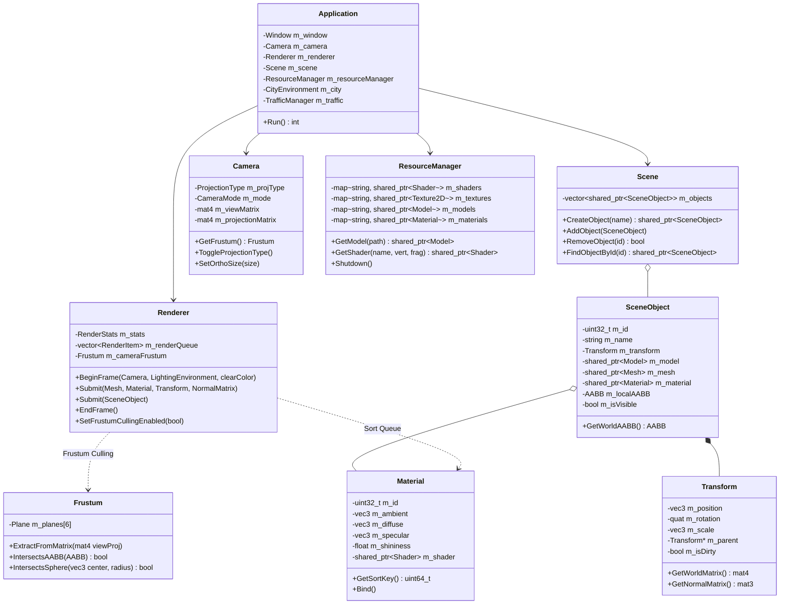

# SmartCity 3D — Graphics Engine Architecture

## 1. System Overview

SmartCity 3D separates engine systems into distinct, decoupled domains:
- **`core`**: Application lifecycle, window management, event dispatch, fixed-timestep simulation loop, configuration parsing, and leveled logging.
- **`gfx`**: Hardware rendering abstractions, shaders, materials, lights, shadow mapping, camera transformations, view-frustum culling, and skybox rendering.
- **`scene`**: Hierarchical scene graph, spatial transforms, model loading, and lifecycle-managed resource caching.
- **`city`**: Procedural urban intersection, road markings, sidewalk and crosswalk geometry, buildings, streetlights, and traffic light assemblies.
- **`sim`**: Microscopic traffic simulation, multi-class vehicles, Intelligent Driver Model (IDM), conflict zones, and lane graph navigation.

---

## 2. Core Class Diagram



---

## 3. Per-Frame Execution Pipeline

Every frame executes through six sequential stages:

```
[ Update Phase ]
      │
      ▼
[ 1. Input & Fixed-Timestep Simulation Update ]
      │  ├─ Poll GLFW window events and mouse/keyboard deltas
      │  ├─ Update Camera matrices and FreeFly / Orbit state
      │  └─ While timer.ShouldSimulateStep():
      │       ├─ Update DayNight sun angle & ambient conditions
      │       └─ Advance TrafficManager (IDM, signals, vehicle positions)
      ▼
[ 2. Pass 1: Shadow Depth Pass ]
      │  ├─ Bind ShadowMap Framebuffer (2048 x 2048 depth-only)
      │  ├─ Calculate Directional Light-Space Orthographic Matrix
      │  └─ Render City and Vehicle geometry to depth texture
      ▼
[ 3. Pass 2: Frustum Culling & Render Queue Submission ]
      │  ├─ Extract 6 Gribb-Hartmann planes from Camera View-Projection Matrix
      │  ├─ Iterate SceneObjects:
      │  │    ├─ Compute transformed World AABB
      │  │    ├─ Test against Frustum planes
      │  │    ├─ Culled? -> increment culledObjects, skip
      │  │    └─ Visible? -> push RenderItems to sorted Render Queue
      │  └─ Sort Render Queue by 64-bit key: (ShaderID << 32) | MaterialID
      ▼
[ 4. Pass 2: Scene Geometry Render Pass ]
      │  ├─ Bind Default Framebuffer & Clear Color/Depth buffers
      │  ├─ Configure Depth Test (GL_LESS) & Face Culling (GL_BACK, GL_CCW)
      │  ├─ Execute sorted Render Queue (batching Shader and Material state changes)
      │  ├─ Render City infrastructure & vehicles with Blinn-Phong lighting
      │  └─ Unbind textures and shaders
      ▼
[ 5. Pass 2: Skybox Render Pass ]
      │  ├─ Set glDepthFunc(GL_LEQUAL)
      │  ├─ Remove translation from View Matrix (mat4(mat3(view)))
      │  ├─ Render skybox cube / procedural gradient (depth z=w=1.0)
      │  └─ Restore glDepthFunc(GL_LESS)
      ▼
[ 6. Pass 3: Diagnostics & ImGui UI Overlay ]
      │  ├─ Calculate rolling 60-frame Avg/Min/Max FPS and frame ms
      │  ├─ Render control panels (Camera, Lighting, Material Inspector, Traffic)
      │  ├─ ImGui_ImplOpenGL3_RenderDrawData()
      │  └─ glfwSwapBuffers()
```

---

## 4. Ownership, Memory & Lifetime Rules

1. **No Raw Owning Pointers**:
   - All OpenGL buffers, textures, shaders, and framebuffers are wrapped in RAII classes (`VertexArray`, `VertexBuffer`, `IndexBuffer`, `Texture2D`, `Shader`, `ShadowMap`).
   - Destructors call the appropriate `glDelete*` function only while the OpenGL context remains valid.

2. **Resource Manager Centralization**:
   - Assets (textures, shaders, 3D models, materials) are loaded once through `ResourceManager::Get()`.
   - Returns immutable `std::shared_ptr<T>`.
   - Repeated requests for the same path return the cached pointer without disk I/O.
   - On `ResourceManager::Shutdown()`, maps are cleared and ref-counts are inspected; a leak summary is logged confirming zero dangling resources.

3. **Scene Graph Ownership**:
   - `scene::Scene` owns its top-level `std::shared_ptr<SceneObject>` instances.
   - Child objects are owned by their respective parents via `std::shared_ptr<SceneObject>`.
   - `Transform::SetParent()` maintains raw back-pointers to parent transforms without circular ownership.
   - Clearing or destroying a `Scene` releases only the objects it holds without destroying shared models or textures in `ResourceManager`.

