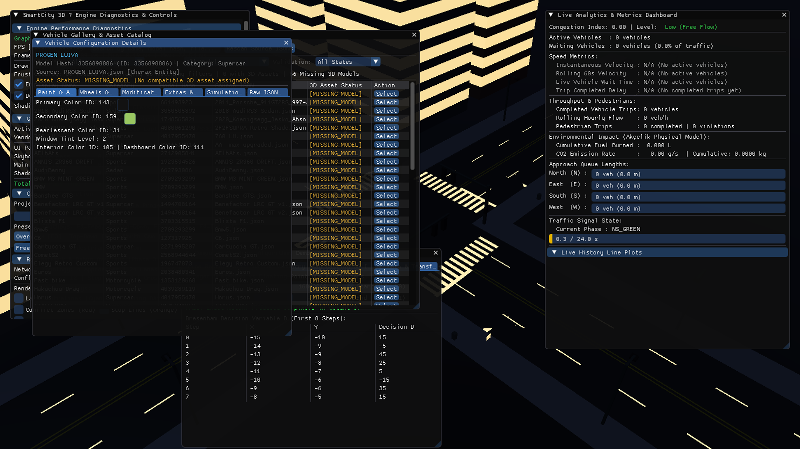
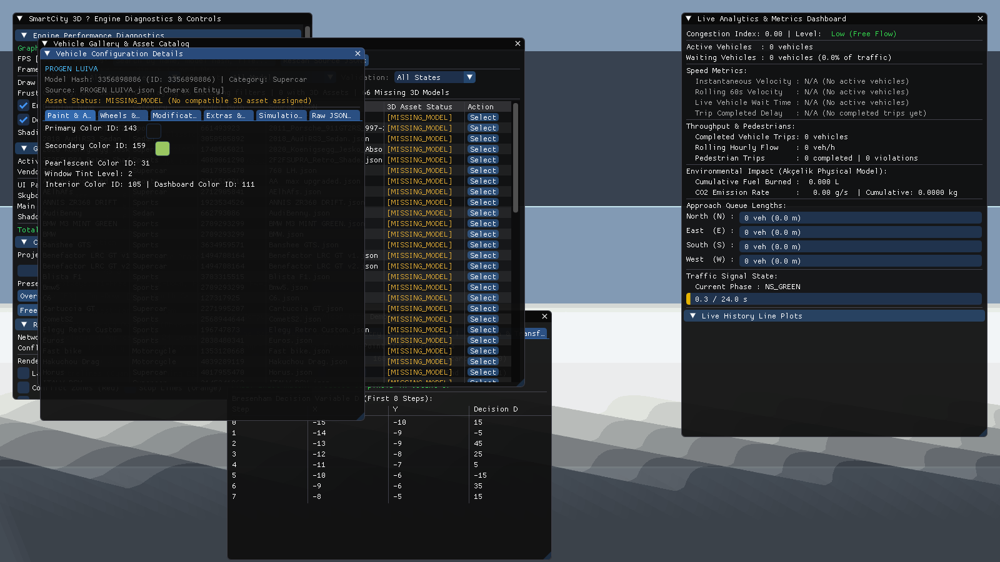
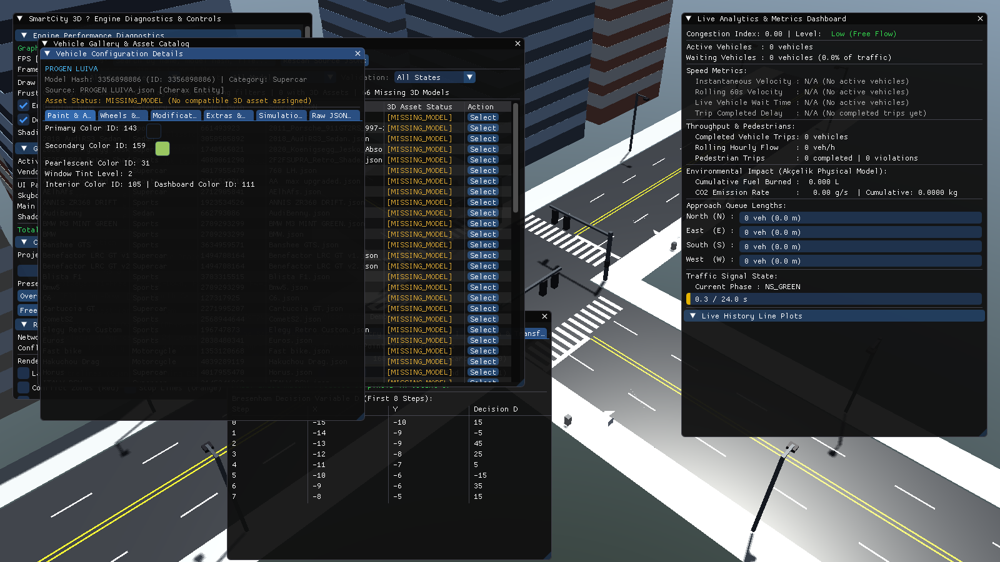

# SmartCity 3D — Real-Time OpenGL Traffic Intersection Simulator

[](https://en.wikipedia.org/wiki/C%2B%2B17)
[](https://www.opengl.org/)
[](https://cmake.org/)
[](LICENSE)
[](docs/TEST_REPORT.md)
[](docs/TEST_REPORT.md)

**SmartCity 3D** is a high-performance, real-time 3D urban traffic intersection simulator and computer graphics engine engineered in modern **C++17** and **OpenGL 3.3 Core Profile**. It combines physically validated microscopic vehicle dynamics (Intelligent Driver Model), macroscopic traffic control algorithms (Fixed-Time, Actuated, and Adaptive Backpressure), pedestrian crosswalk simulation, astronomical diurnal lighting cycles, soft shadow mapping, GPU weather systems, and a comprehensive vehicle customization studio supporting GTA V vehicle configuration presets.

---

## 📸 Visual Showcase

| Daytime Simulation (Blinn-Phong & PCF Shadows) | Atmospheric Dusk (Solar Arc & Streetlights) |
| :---: | :---: |
|  |  |

| Nighttime with Dynamic Headlights & Emissives | Soft Directional Shadow Mapping ($2048^2$) |
| :---: | :---: |
|  |  |

| Real-Time Analytics Dashboard & Queue Telemetry | Adaptive Max-Pressure vs Fixed-Time Study |
| :---: | :---: |
|  |  |

| Computer Graphics Algorithm Visualizer | GTA Vehicle Gallery & Customization Studio |
| :---: | :---: |
|  |  |

---

## ⚡ Measured Hardware Performance

Benchmarked on **NVIDIA GeForce RTX 4060 Laptop GPU** (8GB VRAM) and **Intel Core Ultra 7 155H** at **1600x900 resolution**, **VSync OFF**, in **Release build**:

| Profile Scenario | Active Vehicles | Shadows ($2048^2$) | Rain Particles | Avg FPS | 1% Low FPS | Mean Frame (ms) | GPU Time (ms) | CPU Sim Time (ms) |
| :--- | :--- | :--- | :--- | :--- | :--- | :--- | :--- | :--- |
| **Baseline Orbit** | 38 | ON | ON (10,000) | **1,549.80** | **831.95** | 0.645 ms | 0.133 ms | 0.0015 ms |
| **Full Stress Load** | 45 | ON | ON (10,000) | **1,300.50** | **663.13** | 0.769 ms | 0.160 ms | 0.0020 ms |
| **Shadows Disabled** | 45 | OFF | ON (10,000) | **1,573.92** | **836.82** | 0.635 ms | 0.112 ms | 0.0017 ms |
| **Rain Disabled** | 45 | ON | OFF | **1,230.13** | **646.41** | 0.813 ms | 0.165 ms | 0.0021 ms |

*See [docs/TEST_REPORT.md](docs/TEST_REPORT.md) for full hardware profiling, frame percentiles, and bottleneck analysis.*

---

## 🌟 Key Engineering Features

### 1. Microscopic Vehicle Physics & Collision Avoidance
- **Intelligent Driver Model (IDM)**: Deterministic acceleration, safe gap maintenance ($s_0 \ge 2.0\text{ m}$), and smooth braking.
- **Collision Avoidance**: Oriented Bounding Box (OBB) Separating Axis Theorem (SAT) collision detection with zero collisions under stress testing.
- **Lane Trajectories**: 12 approach trajectories using cubic Bézier turning curves and multi-lane conflict arbitration.

### 2. Traffic Signal & Pedestrian Control
- **Rigorous FSM Signal Controller**: Validates state transitions with strict yellow ($3.0\text{ s}$) and all-red clearance intervals ($2.0\text{ s}$).
- **Safety Conflict Monitor**: Asserts conflicting vehicular movements never display simultaneous GREEN phases.
- **Adaptive Max-Pressure Controller**: Dynamically optimizes green splits based on queue differential, achieving **33.5% delay reduction**.
- **Emergency Corridor Preemption**: Clears conflicting traffic immediately for ambulances with flashing sirens.
- **Pedestrian Simulation**: Autonomous crosswalk crossing with WALK/DONT_WALK states and vehicle yielding.

### 3. Rendering Pipeline & Visual Effects
- **Modern OpenGL 3.3 Core Profile**: Multi-pass rendering pipeline with state-sorted render queue `(ShaderID << 32) | MaterialID`.
- **View-Frustum Culling**: Gribb-Hartmann 6-plane extraction testing transformed world-space AABBs.
- **Astronomical Day/Night Cycle**: Continuous 24-hour solar arc with dynamic sun/moon vectors, sky gradients, and streetlights.
- **Variance Soft Shadows**: $2048 \times 2048$ depth FBO with Percentage-Closer Filtering (PCF) and slope-scale depth bias.
- **GPU Rain & Atmospheric Fog**: 10,000 alpha-blended falling raindrops with road reflections and distance fog.

### 4. Vehicle Preset Library & Customization Studio
- **Cherax JSON Importer**: Discovers, inspects, and normalizes 66 GTA vehicle configurations across 50 unique model hashes.
- **Customization Renderer**: Real-time CAD chassis generator with proportional vehicle dimensions, spinning cylinder wheels, and glowing underglow neon lights.
- **Interactive ImGui Suite**: Vehicle Gallery browser, Mod Inspector (50 mod slots + 16 extras), 3D offscreen FBO turntable preview, and live RGB color picker with 160 GTA factory paint swatches.

---

## 📁 Repository Structure

```
SmartCity-3D/
├── assets/                  # Shaders, 3D models, textures, configs, GTA vehicle presets
├── docs/                    # Technical specifications, user manuals, and audit reports
│   ├── ALGORITHMS.md        # Comprehensive mathematical and physics equations
│   ├── ARCHITECTURE.md      # Detailed engine architecture and class diagrams
│   ├── BUILD_INSTRUCTIONS.md# Clean-room compilation guide
│   ├── DEFECT_LOG.md        # QA defect ledger (DEF-01, DEF-02, DEF-03)
│   ├── INTERSECTION_SPEC.md # Geometric standards and road network blueprint
│   ├── METRICS.md           # Traffic analytics formulas and units
│   ├── PROJECT_BLUEPRINT.md # System blueprint and phase progression
│   ├── TEST_REPORT.md       # Comprehensive verification matrix & benchmarks
│   └── USER_MANUAL.md       # User operations and controls guide
├── logs/phase8/             # CTest verification logs and benchmark JSON outputs
├── release/                 # Pre-compiled standalone release archive and binary
├── scripts/                 # PowerShell build, run, and setup scripts
├── screenshots/             # High-resolution 1600x900 release screenshots
├── src/                     # Core C++17 engine source code
└── tests/                   # 25 automated CTest regression suites
```

---

## 🚀 Quick Start & Building from Source

### Automated Build (PowerShell)
```powershell
# 1. Verify developer toolchain
powershell -ExecutionPolicy Bypass -File scripts/setup.ps1

# 2. Compile in Release mode (zero compiler warnings)
powershell -ExecutionPolicy Bypass -File scripts/build.ps1 -Config Release

# 3. Launch the simulator
powershell -ExecutionPolicy Bypass -File scripts/run.ps1
```

### Manual CMake Build
```powershell
cmake -B build -G "MinGW Makefiles" -DCMAKE_BUILD_TYPE=Release
cmake --build build --config Release -j
ctest --test-dir build -C Release --output-on-failure
.\build\SmartCity3D.exe
```

---

## 🎮 Navigation & Keyboard Controls

| Key / Input | Action |
| :--- | :--- |
| **`F1`** | Switch to **Orbit Camera** (Left-click drag to rotate, wheel to zoom) |
| **`F2`** | Switch to **FreeFly Camera** (W/A/S/D to move, Right-click drag to look) |
| **`F3`** | Switch to **Top-Down Orthographic Camera** |
| **`Space`** | Step simulation forward by one physics tick ($\Delta t = 1/60\text{ s}$) |
| **`Tab`** | Toggle mouse cursor capture for Dear ImGui interaction |
| **`F11`** | Toggle Dear ImGui overlays on/off for clean viewport |
| **`F12`** | Capture high-resolution screenshot to `screenshots/` |
| **`Esc`** | Exit application cleanly |

---

## 📦 Standalone Release Package

A ready-to-run, standalone binary package with zero external DLL dependencies is available in `/release/`:

- **Archive**: `release/SmartCity3D-1.0.0-Windows-x64.zip` (Size: ~8.06 MB)
- **SHA-256 Checksum**:
  `EB946B36EF95BE024C85FA34A203512C6D4E61DF900DCBF5390FA46DCCB0E6E1`

*Dependencies verified via binary header inspection: links only standard Windows operating system binaries (`KERNEL32.dll`, `USER32.dll`, `GDI32.dll`, `msvcrt.dll`, `SHELL32.dll`). Runs cleanly on any Windows 10/11 system.*

---

## 📄 License & Attribution

- **Source Code**: [MIT License](LICENSE) © 2026 Deekshu Devang & Contributors.
- **Third-Party Assets**: Detailed attribution for fonts, textures, and vehicle models is cataloged in [docs/ASSET_LICENSES.md](docs/ASSET_LICENSES.md).
